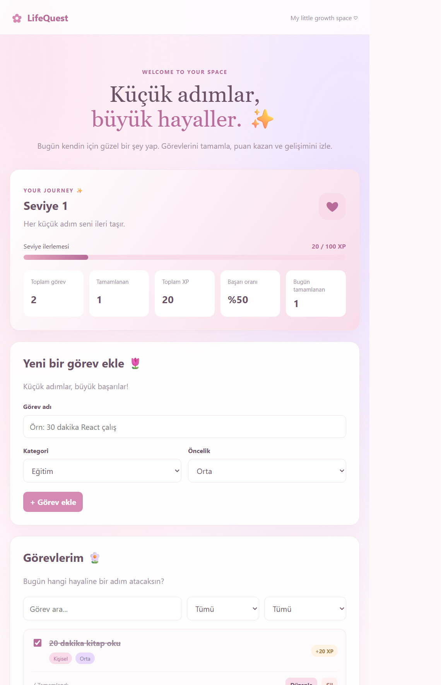

# LifeQuest

LifeQuest, günlük görevleri düzenlemek ve küçük ilerlemeleri takip etmek için hazırlanmış React uygulamasıdır. Görev tamamlandıkça XP kazanılır; görevler bu tarayıcıda saklanır.

## Özellikler

- Görev ekleme, düzenleme, tamamlama ve silme
- Kategori, öncelik ve duruma göre filtreleme; görev arama
- Görev önceliğine göre XP ve her 100 XP'de seviye ilerlemesi
- Tamamlanan görev, bugün tamamlanan görev ve başarı oranı özeti
- Tarayıcı LocalStorage alanında kayıt
- Telefon ve masaüstü ekranlarına uyumlu soft pembe tasarım

## Ekran görüntüsü



## Çalıştırma

Node.js kurulu olmalıdır. Proje klasöründe terminal açıp şu komutları çalıştır:

```bash
npm install
npm run dev
```

Terminalde gösterilen yerel adresi tarayıcıda aç. Üretim derlemesini kontrol etmek için:

```bash
npm run lint
npm run build
```

## Veri hakkında

Görevler yalnızca kullanıldıkları tarayıcının LocalStorage alanında tutulur. Tarayıcı verileri temizlenirse görevler silinir; başka cihazlarla eşitlenmez.

## Netlify'da yayınlama

GitHub deposunu Netlify'a bağladıktan sonra build komutunu `npm run build`, yayın klasörünü `dist` olarak ayarla. Uygulama yayımlandıktan sonra Netlify'ın verdiği bağlantıyı paylaşabilirsin.
